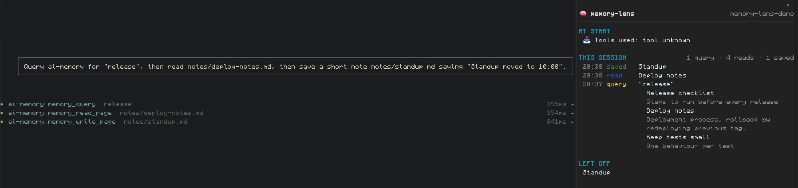
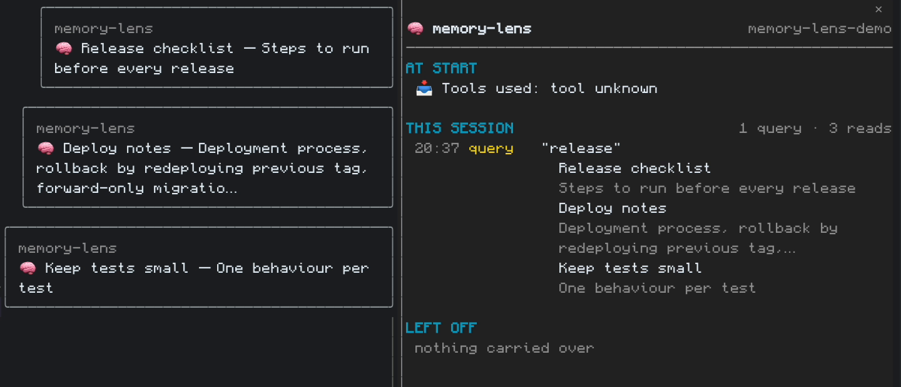
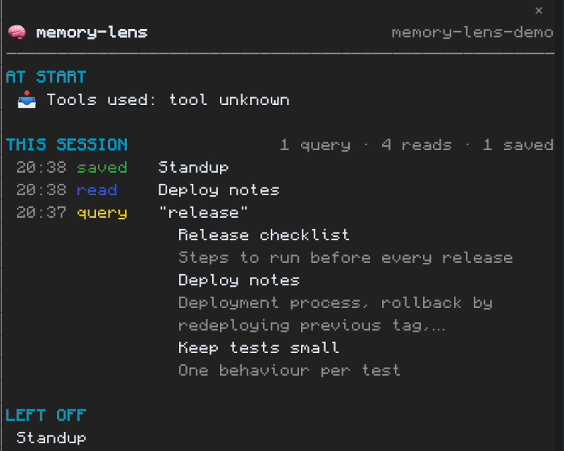

# memory-lens

A read-only Claude Code mod that shows what [ai-memory](https://github.com/akitaonrails/ai-memory) does during a session. It raises a short toast whenever a memory page is read, and keeps a side pane with what was injected at session start, what was saved and read during the session, and where the last session left off. It never writes to ai-memory.



## Requirements

- Claude Code 2.1.287 or later (the mods engine).
- ai-memory, with its MCP server registered as `ai-memory` and its lifecycle hooks installed. See the [ai-memory README](https://github.com/akitaonrails/ai-memory) for setup.
- A `.ai-memory.toml` with `workspace` and `project`, at or above the working directory.

Without a `.ai-memory.toml`, toasts and pane rows for Claude's own memory calls still work. The mod's own lookups need it: the LEFT OFF section and the page reads behind summaries.

## Install

Type at the Claude Code prompt:

```
/plugin install memory-lens --marketplace sousair/memory-lens
```

Answer `y` to add the marketplace, then pick a scope. Run `/reload-plugins` or restart Claude Code.

## Use

`/mem` (or `/memory-lens`) toggles the pane. A pane that opened automatically is pinned by `/mem`, so it stays open.

Toasts: one per page read, shown once per session for each page, capped per prompt (see `toastCap`).



The pane has three sections:

- **AT START**: the handoff and rules ai-memory injected when the session began.
- **THIS SESSION**: what was saved and read, with counts. Queries show as `query "…"` rows with their hits underneath. Pages from another project carry a `[project]` tag. Session pages are hidden.
- **LEFT OFF**: where the previous session stopped.

Earlier memory calls in the session are backfilled from the transcript when the pane opens.



## Settings

| Setting | Default | Meaning |
| --- | --- | --- |
| `mode` | `auto` | `on`: open the pane at session start and keep it open. `off`: never open it by itself; `/mem` still toggles it. `auto`: open on a pending handoff, a last-session line, or a memory write or handoff, and close after about 25 s idle (only where the pane can dock). |
| `toastSeconds` | `6` | How long a memory toast stays visible. |
| `toastCap` | `12` | Maximum memory toasts per prompt. |
| `summaries` | `on` | `on`: ask the model for a short name/summary when a page has none. `off`: show stored text only. |

Change them with `/plugin` and configure memory-lens, or set them under `pluginConfigs` in your Claude Code settings.

## Privacy and trust

- Read-only: memory-lens never writes to ai-memory.
- Memory text is treated as untrusted data: it is displayed, never followed as instructions.
- Files it reads: `.ai-memory.toml` (to find the workspace and project), Claude Code's saved hook-output files (to read ai-memory's full session-start brief when it was too large to inject inline), and the session transcript under `~/.claude/projects/` (to backfill earlier calls).
- Summaries use a Haiku one-liner through the session's own model credentials, cached locally per page version. Set `summaries` to `off` to disable.

## Develop

```
claude --plugin-dir .
claude plugin test .
claude plugin validate .claude-plugin/plugin.json
```

## License

MIT. See `LICENSE`.
